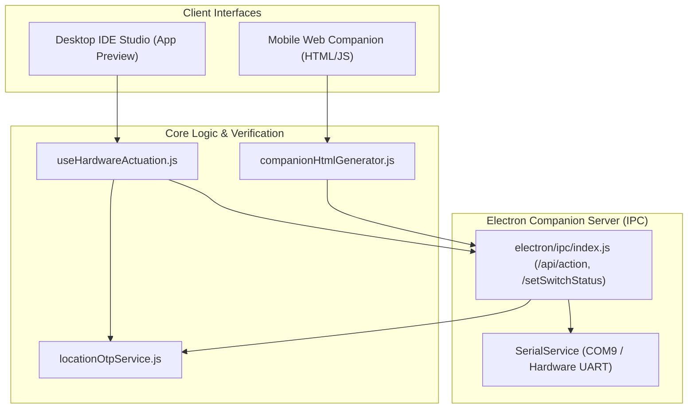
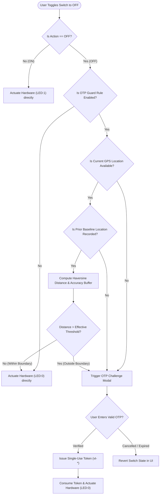
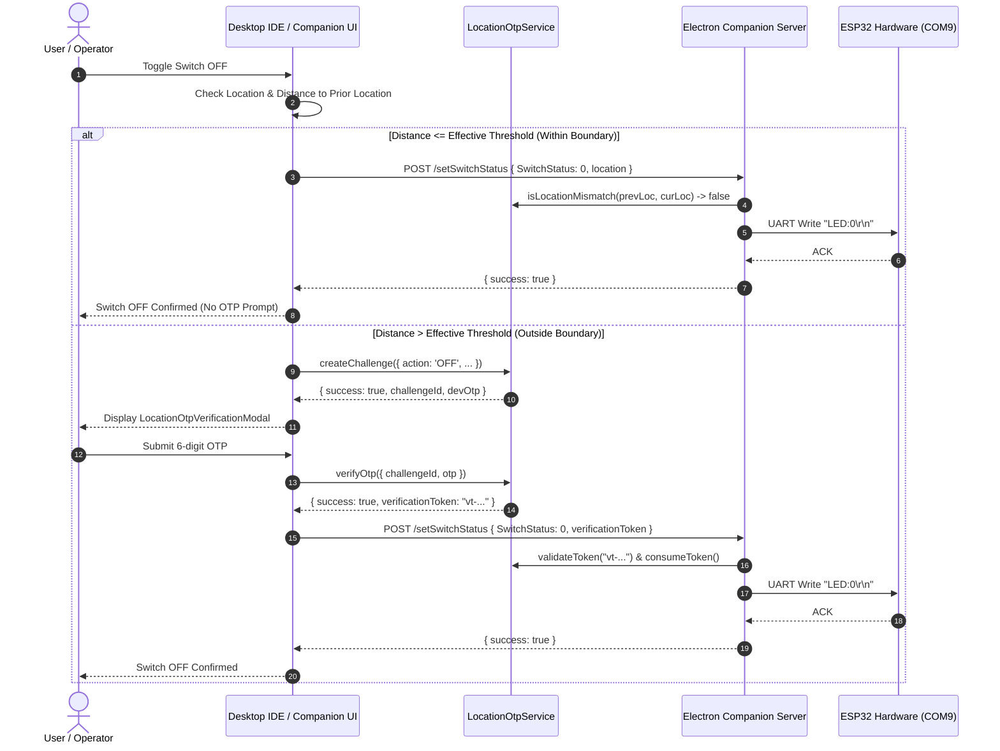

# Location-Mismatch OTP Verification & Boundary Check Specification

## Executive Summary

In the InnoIDE ESP32 Companion architecture, **OTP verification is NOT required to turn OFF a switch or hardware device when the current location is within the boundary** (distance $\le$ configured threshold), provided that a valid prior Turn-ON location baseline exists and current GPS coordinates are available.

The system is explicitly designed as a **Location-Mismatch Guard**. Its primary intent is to guard against unauthorized switch-off operations that occur outside the expected perimeter or after significant physical displacement from where the device was originally turned ON.

> [!NOTE]
> **Summary Rule**:
> - **Location Within Boundary**: Immediate switch-off without OTP prompt.
> - **Location Outside Boundary**: 6-digit OTP challenge required before actuation.
> - **Exceptions**: Edge cases (such as missing prior location history, GPS permission denial, or stale geo-logs) will trigger the OTP challenge even if the device is physically near the reference boundary.

---

## Architectural Component Overview

The location boundary and OTP validation subsystem spans four main layers:



1. **[locationOtpService.js](file:///C:/Users/Dell%205530/.gemini/antigravity/worktrees/ide-desktop-app/otp_location_boundary_check/src/components/esp32/locationOtpService.js)**:
   Calculates great-circle distance (Haversine formula), computes GPS accuracy drift buffers, issues cryptographic 6-digit OTPs, and manages single-use verification tokens (`vt-*`).
2. **[electron/ipc/index.js](file:///C:/Users/Dell%205530/.gemini/antigravity/worktrees/ide-desktop-app/otp_location_boundary_check/electron/ipc/index.js)**:
   Companion Server endpoints (`/setSwitchStatus`, `/api/action`, `/api/otp/*`). Enforces server-side verification before passing serial commands (`LED:0\r\n`) to hardware.
3. **[useHardwareActuation.js](file:///C:/Users/Dell%205530/.gemini/antigravity/worktrees/ide-desktop-app/otp_location_boundary_check/src/components/esp32/useHardwareActuation.js)**:
   Controls Desktop IDE toggle interactions, initiates OTP challenge modals when location mismatch occurs, and resolves user tokens.
4. **[companionHtmlGenerator.js](file:///C:/Users/Dell%205530/.gemini/antigravity/worktrees/ide-desktop-app/otp_location_boundary_check/src/components/esp32/companionHtmlGenerator.js)**:
   Generates the standalone mobile HTML companion app loaded via QR code. Evaluates client-side geofence rules and triggers local/remote OTP challenges.
5. **[flasherConstants.js](file:///C:/Users/Dell%205530/.gemini/antigravity/worktrees/ide-desktop-app/otp_location_boundary_check/src/components/flasherConstants.js)**:
   Contains rule schemas, default thresholds ($50\text{m}$), condition type definitions, and calibrated office location constants (`PRIMARY_OFFICE_LOCATION`).

### Calibrated Primary Office Location Constant
- **Facility / Lab**: Chennai Office (Primary Location) — Innotrat Labs
- **Latitude**: `13.0185° N`
- **Longitude**: `80.2227° E`
- **Address**: `Door No. 17/A, Muthayal Naidu Street, Little Mount, Saidapet, Chennai, Tamil Nadu 600015`
- **Default Geofence Threshold**: `50 meters`

---

## Distance & Boundary Evaluation Math

### 1. Haversine Distance Formula
In [locationOtpService.js#L28-L50](file:///C:/Users/Dell%205530/.gemini/antigravity/worktrees/ide-desktop-app/otp_location_boundary_check/src/components/esp32/locationOtpService.js#L28-L50), distance between previous location $(lat_1, lon_1)$ and current location $(lat_2, lon_2)$ is computed:

$$d = 2 R \cdot \arcsin\left(\sqrt{\sin^2\left(\frac{\Delta lat}{2}\right) + \cos(lat_1)\cos(lat_2)\sin^2\left(\frac{\Delta lon}{2}\right)}\right)$$

Where $R = 6,371,000\text{ meters}$.

### 2. GPS Accuracy Buffer
To prevent false alarms caused by satellite jitter and GPS inaccuracy, the system adds a dynamic buffer capped at $50\text{ meters}$:

$$\text{accuracyBuffer} = \min\left(\max(\text{acc}_{\text{prev}}, \text{acc}_{\text{cur}}), 50\right)$$
$$\text{effectiveThreshold} = \text{thresholdMeters} + \text{accuracyBuffer}$$

```javascript
// locationOtpService.js line 107-112
const prevAcc = Number(prevLoc.accuracy || 0);
const curAcc = Number(curLoc.accuracy || 0);
const accuracyBuffer = Math.min(Math.max(prevAcc, curAcc), 50);
const effectiveThreshold = thresholdMeters + accuracyBuffer;

const isMismatch = rawDist > effectiveThreshold;
```

If $\text{rawDist} \le \text{effectiveThreshold}$, `isMismatch` is **`false`**.

---

## Decision Matrix

| Operation | User Location Status | Prior Baseline Location | OTP Required? | Resulting Action |
| :--- | :--- | :--- | :--- | :--- |
| **Turn ON** | Any | Any | **NO** | Serial command `LED:1` sent immediately |
| **Turn OFF** | Within Boundary ($\le \text{Threshold}$) | Valid Recorded Location | **NO** | Serial command `LED:0` sent immediately |
| **Turn OFF** | Outside Boundary ($> \text{Threshold}$) | Valid Recorded Location | **YES** | OTP challenge requested; UI prompts user |
| **Turn OFF** | Physically within boundary | **None recorded** (`!prevLoc`) | **YES** *(In Web Companion)* | Fallback safety guard triggers OTP challenge |
| **Turn OFF** | Physically within boundary | **GPS Missing / Denied** | **YES** | `MISSING_CURRENT_LOCATION` triggers OTP |
| **Turn OFF** | Physically within boundary | **Coordinates Invalid** | **YES** | `INVALID_COORDINATES` triggers OTP |

---

## Detailed Edge Case Analysis

While the design does not require OTP within the boundary, there are four scenarios where an OTP prompt will appear even if the user is physically within the boundary:

### 1. Missing Prior Baseline (`!prevOperationLoc`) in Web Companion
In [companionHtmlGenerator.js#L2457-L2462](file:///C:/Users/Dell%205530/.gemini/antigravity/worktrees/ide-desktop-app/otp_location_boundary_check/src/components/esp32/companionHtmlGenerator.js#L2457-L2462):
```javascript
var locationMismatchExceedsThreshold =
  !prevOperationLoc ||              // No prior location -> ALWAYS GUARD
  rawDistance == null ||            // Couldn't compute distance -> GUARD
  rawDistance > ruleThreshold;      // Actual movement > configured threshold

var requiresOtp = isSwitchOff && hasOtpRule && locationMismatchExceedsThreshold;
```
If a user loads the companion web app and immediately toggles the switch to **OFF** without having first toggled it to **ON** during that session, `prevOperationLoc` is `null`. The system cannot compute relative distance and flags `locationMismatchExceedsThreshold = true`.

### 2. Geolocation Permission Denied or GPS Unavailable
In [locationOtpService.js#L79-L87](file:///C:/Users/Dell%205530/.gemini/antigravity/worktrees/ide-desktop-app/otp_location_boundary_check/src/components/esp32/locationOtpService.js#L79-L87):
```javascript
if (!curLoc || (curLoc.lat == null && curLoc.latitude == null) || (curLoc.lng == null && curLoc.longitude == null)) {
  return {
    isMismatch: true,
    distance: null,
    threshold: thresholdMeters,
    reason: 'MISSING_CURRENT_LOCATION'
  };
}
```
If browser location permissions are disabled or GPS hardware is unavailable, the system safely falls back to requiring OTP verification rather than permitting silent actuation.

### 3. Stale Geo-log Filtering
Both the Electron backend and mobile companion run timestamp sanitization:
- Backend: `isStaleGeolog(l)` in [electron/ipc/index.js#L58](file:///C:/Users/Dell%205530/.gemini/antigravity/worktrees/ide-desktop-app/otp_location_boundary_check/electron/ipc/index.js#L58)
- Mobile Client: `isStaleClientGeolog(item)` in [companionHtmlGenerator.js#L848](file:///C:/Users/Dell%205530/.gemini/antigravity/worktrees/ide-desktop-app/otp_location_boundary_check/src/components/esp32/companionHtmlGenerator.js#L848)

Logs containing pre-canned demo timestamps (e.g., `12:53:01`, `12:34:55`, `loc-init-1`) are filtered out. If the only recorded location was a demo artifact, the baseline is cleared, reverting to the missing-baseline condition.

### 4. Development & Demo Mode Quick-Fill
When testing in local development:
- `defaultLocationOtpService.devDemoMode` is enabled by default.
- The generated 6-digit OTP is surfaced directly in the modal (`challengeData.devOtp`) with a 1-click **Quick Fill** button.
- In offline/fallback mode, client-issued fallback tokens (`vt-local-*`, `vt-demo-*`) are accepted by [locationOtpService.js#L533-L543](file:///C:/Users/Dell%205530/.gemini/antigravity/worktrees/ide-desktop-app/otp_location_boundary_check/src/components/esp32/locationOtpService.js#L533-L543).

---

## Execution Flowcharts

### Switch OFF Decision Flowchart



### Hardware Verification Sequence Diagram



---

## File and Line Number Trace

| Component / Function | File Reference | Line Numbers |
| :--- | :--- | :--- |
| Distance Calculation & Mismatch Check | [locationOtpService.js](file:///C:/Users/Dell%205530/.gemini/antigravity/worktrees/ide-desktop-app/otp_location_boundary_check/src/components/esp32/locationOtpService.js) | [L28-L50](file:///C:/Users/Dell%205530/.gemini/antigravity/worktrees/ide-desktop-app/otp_location_boundary_check/src/components/esp32/locationOtpService.js#L28-L50), [L68-L122](file:///C:/Users/Dell%205530/.gemini/antigravity/worktrees/ide-desktop-app/otp_location_boundary_check/src/components/esp32/locationOtpService.js#L68-L122) |
| Server-Side OTP Verification & Token Consumption | [electron/ipc/index.js](file:///C:/Users/Dell%205530/.gemini/antigravity/worktrees/ide-desktop-app/otp_location_boundary_check/electron/ipc/index.js) | [L921-L956](file:///C:/Users/Dell%205530/.gemini/antigravity/worktrees/ide-desktop-app/otp_location_boundary_check/electron/ipc/index.js#L921-L956) |
| Desktop Toggle Mismatch Evaluation | [useHardwareActuation.js](file:///C:/Users/Dell%205530/.gemini/antigravity/worktrees/ide-desktop-app/otp_location_boundary_check/src/components/esp32/useHardwareActuation.js) | [L100-L105](file:///C:/Users/Dell%205530/.gemini/antigravity/worktrees/ide-desktop-app/otp_location_boundary_check/src/components/esp32/useHardwareActuation.js#L100-L105) |
| Mobile Companion Client Location Mismatch & Fallback Guard | [companionHtmlGenerator.js](file:///C:/Users/Dell%205530/.gemini/antigravity/worktrees/ide-desktop-app/otp_location_boundary_check/src/components/esp32/companionHtmlGenerator.js) | [L2447-L2465](file:///C:/Users/Dell%205530/.gemini/antigravity/worktrees/ide-desktop-app/otp_location_boundary_check/src/components/esp32/companionHtmlGenerator.js#L2447-L2465) |
| OTP Verification UI Modal & Countdown Synchronizer | [LocationOtpVerificationModal.jsx](file:///C:/Users/Dell%205530/.gemini/antigravity/worktrees/ide-desktop-app/otp_location_boundary_check/src/components/esp32/LocationOtpVerificationModal.jsx) | [L28-L178](file:///C:/Users/Dell%205530/.gemini/antigravity/worktrees/ide-desktop-app/otp_location_boundary_check/src/components/esp32/LocationOtpVerificationModal.jsx#L28-L178) |
| Rule Specification & Geofence Default Thresholds | [flasherConstants.js](file:///C:/Users/Dell%205530/.gemini/antigravity/worktrees/ide-desktop-app/otp_location_boundary_check/src/components/flasherConstants.js) | [L36-L47](file:///C:/Users/Dell%205530/.gemini/antigravity/worktrees/ide-desktop-app/otp_location_boundary_check/src/components/flasherConstants.js#L36-L47) |
